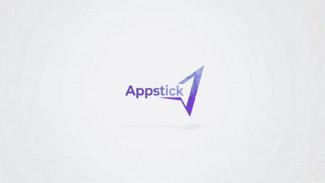
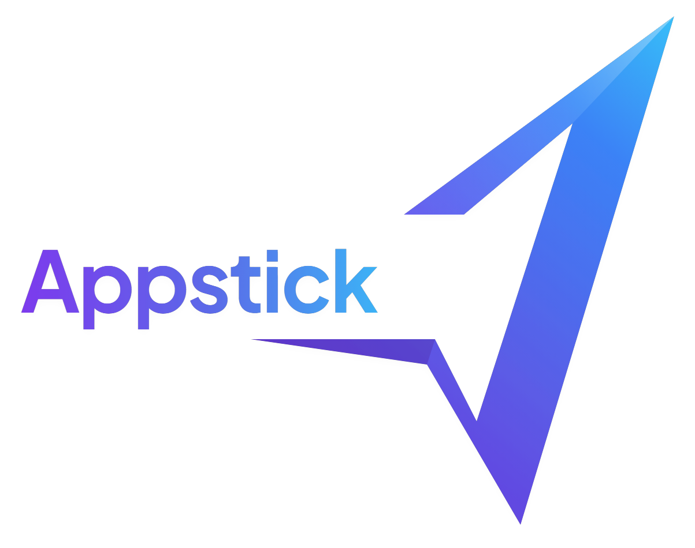

# AppStick Software Engineering Portfolio
### Software Engineer

Crafted by **[MD. Mahfujul Karim Sheikh](https://github.com/mmks735)** during tenure at **[AppStick Ltd](https://appstick.com.bd)**

  
  
  
  

> *A comprehensive software engineering portfolio documenting end-to-end production systems, product R&D and UI/UX design, real-time architectures, and rigorous SQA validation delivered at AppStick Ltd.*

---

## ⚡ Projects Showcase Matrix

| Application & Focus | Key Engineering Highlights | Tech Stack | Deliverables & Links |
| :--- | :--- | :--- | :--- |
| 🛒 **GreenCart (HanaGo)** `AI Retail & Smart Grocery • Role: End-to-End Dev` | • End-to-end development of AI voice & text shopping assistant • Built 26+ production screens with reactive GetX state & REST APIs • Implemented 4-step live fulfillment stepper & scheduled slot delivery | `Flutter` `GetX` `Voice/NLP` `REST API` | [🚀 Web Demo](https://mmks735.github.io/greencart/) [🌐 Live Docs](https://docs.greencart.appstick.com.bd/) [💻 GitHub Repo](https://github.com/mmks735/greencart) |
| 🚗 **Vincy Rideshare** `Client Project (Driver + Rider) • Role: End-to-End Dev` | • End-to-end client delivery of dual Driver & Rider apps with live GPS sync • Built turn-by-turn navigation, WebSockets & live animated bearing • Engineered automated fare metering & bus schedule integration | `Flutter` `Google Maps` `WebSockets` `Geo-Tracking` | 🚘 **Driver App:** [🌐 Live Docs](https://mmks735.github.io/uberdriver/) • [💻 GitHub Repo](https://github.com/mmks735/uberdriver)  📱 **Rider App:** [🌐 Live Docs](https://mmks735.github.io/uberuser/) • [💻 GitHub Repo](https://github.com/mmks735/uberuser) |
| 📊 **HealthTrack** `Personal Health Companion • Role: R&D, Design & A–Z Dev` | • Led product scoping, R&D, UI/UX design & full A–Z Flutter development • Built glucose, BP (AHA), weight/BMI, pain body map & PDF/Excel reports • Engineered offline-first architecture, Google Drive sync & 12 languages | `Flutter` `R&D & UI/UX` `FL Chart` `Offline-First` | [🌐 Live Website](https://healthtrack.appstick.com.bd/) [📱 Google Play](https://play.google.com/store/apps/details?id=bd.com.appstick.healthtrack) |
| 🎯 **Habitly** `Habit & Focus Companion • Role: End-to-End Dev (UI Assist)` | • End-to-end Flutter development (with design assistance) from core to release • Built custom habit routines, smart reminders & Pomodoro timer (5m–45m) • Implemented streak analytics, weekly growth graphs & consistency heatmaps | `Flutter` `Pomodoro Timer` `Analytics` `Offline-First` | [🌐 Live Website](https://habitly.appstick.com.bd/) [📱 Google Play](https://play.google.com/store/apps/details?id=com.appstick.habitly) |
| 🛡️ **Metadata Cleaner** `Offline Privacy Sanitizer • Role: R&D, Design & A–Z Dev` | • Led product scoping, R&D, UI/UX design & full A–Z Flutter development • Engineered offline binary inspection & lossless Wipe/Ghost Masking (EXIF, GPS, AI/C2PA) • Built 20+ batch cleaner, Clean PDF/PNG/ZIP tools & Firebase Auth | `Flutter` `R&D & UI/UX` `Binary / EXIF` `Firebase Auth` | 🔒 Private Repo [📱 Google Play](https://play.google.com/store/apps/details?id=bd.com.appstick.metadatacleaner) |
| 🏍️ **MotoCare** `Vehicle Maintenance • Role: SQA` | • End-to-end SQA testing for fuel efficiency tracking & service logbook • Verified automated engine oil & maintenance reminder workflows • Functional, regression & release QA validation before Play Store rollout | `SQA` `Functional QA` `Regression Testing` `Release Validation` | [🌐 Live Website](https://motocare.appstick.com.bd/) [📱 Google Play](https://play.google.com/store/apps/details?id=com.appstick.motocare.motocare) |
| 💳 **ExpenseX AI** `AI Expense Manager • Role: SQA` | • Led SQA & bug hunting across OCR receipt scanning, voice & SMS capture • Tested category breakdown, budget planning & cashflow analytics • Performed exploratory testing, edge-case reporting & release stability QA | `SQA` `Bug Hunting` `Exploratory QA` `Release Validation` | [🌐 Live Website](https://expensexai.com/) [📱 Google Play](https://play.google.com/store/apps/details?id=com.expensexai.app) |
| 🏎️ **Car Rush** `2D Physics Game • Role: SQA` | • Executed SQA testing on draw-driving controls & 2D physics collisions • Validated dynamic biomes, obstacle behavior & offline gameplay states • Conducted gameplay QA, stability checks & pre-release verification | `SQA` `Game QA` `Internal Testing` `Release Validation` | [🌐 Live Website](https://carrush.appstick.com.bd) [📱 Google Play](https://play.google.com/store/apps/details?id=bd.com.appstick.currush) |
| 🩸 **Blood Bank** `Emergency Donor Network • Role: SQA` | • Performed SQA verification on proximity donor search & filter workflows • Tested 1-tap emergency dialer, SMS dispatch & 90-day cooldown logic • Validated donor eligibility rules, edge cases & release readiness | `SQA` `Functional QA` `Edge-Case Testing` `Release Validation` | [🌐 Live Website](https://bloodbank.appstick.com.bd/) [📱 Google Play](https://play.google.com/store/apps/details?id=com.appstick.blooddonation) [💻 GitHub Repo](https://github.com/Appstick-Ltd/BloodDonationApp) |

---

## 🏛️ Engineering Standards & Core Capabilities

- **🏗️ Clean Architecture & MVVM:** Strict separation of UI, business logic, and repository layers ensuring high maintainability and testability.
- **🔬 Product Scoping, R&D & UI/UX:** Turning raw ideas into validated product scopes, intuitive interfaces, and complete A–Z production implementations.
- **⚡ Reactive State & Real-Time Systems:** Deterministic state management (GetX/Provider), WebSockets, live geo-tracking, and bearing-adjusted rendering.
- **💾 Offline-First & Binary Engineering:** Local persistence, on-device file/EXIF binary sanitization, and zero-upload privacy resilience.
- **🛡️ Software Quality Assurance (SQA):** End-to-end functional, regression, exploratory, and edge-case testing for stable Play Store releases.

---

## 📬 Contact & Links

### MD. Mahfujul Karim Sheikh
**Software Engineer** @ **[AppStick Ltd](https://appstick.com.bd)**

📍 Khulna, Bangladesh &nbsp;•&nbsp; 🌐 [appstick.com.bd](https://appstick.com.bd)  
📧 [mahfujul.karim@appstick.com.bd](mailto:mahfujul.karim@appstick.com.bd) &nbsp;•&nbsp; 💻 [GitHub: @mmks735](https://github.com/mmks735)

© AppStick Ltd • Built with Flutter & Markdown

